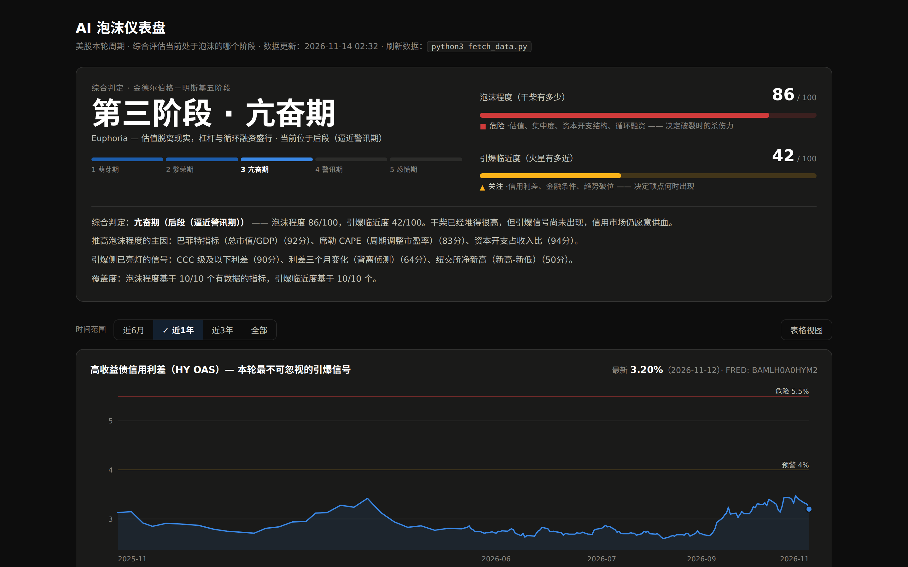
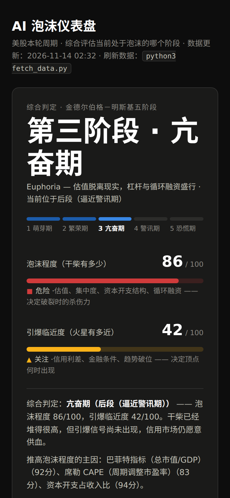

# AI Bubble Dashboard

[简体中文](README.zh-CN.md) | **English** | [日本語](README.md)

A personal research tool for judging which stage of a bubble the current AI rally in US stocks has reached. It is a static page with no framework and no dependencies: open `index.html` and it works. The interface is in Chinese.

Live version: https://bubble.chenfangfang.top

<p>
  
  
</p>

## Usage

**Day to day, double-click `启动仪表盘.command`** (macOS). If the data is more than 12 hours old it fetches fresh data (about 30 seconds), then opens the page.

Manually:

```bash
python3 fetch_data.py     # fetch the latest data and generate data/data.js
open index.html           # open it in the browser directly (no server needed)
```

> Why the page does not fetch the data itself: the browser's cross-origin rules (CORS) do not let a local page read the FRED API, so a script does the fetching. The launcher wraps both steps into one.

## The model (two axes × five stages)

- **Bubble size (the fuel)**: Shiller CAPE, the Buffett indicator, market concentration, capex growth and intensity, debt issuance, circular financing, AI adoption, primary-market froth (IPO boom) and regulators' warnings. This decides how hard the fall will be.
- **Proximity to a trigger (the spark)**: the high-yield credit spread and its 3-month change, the CCC spread, a financial conditions index, the yield curve, VIX, distance from the 200-day moving average, NYSE net new highs (breadth divergence), new-share supply draining money from the market, and the number of companies whose free cash flow has turned negative. This decides when the top arrives.

When "new-share supply draining money" reaches level 3 (financing is booming while the index stalls), it is treated as the top signal to act on first in this cycle. "Net new highs" is updated by hand every week from Reuters or exchange data.

Each indicator is interpolated to a 0–100 score with piecewise thresholds, weighted into the two axis scores, and mapped to the five Kindleberger–Minsky stages (displacement → boom → euphoria → distress → panic). Thresholds and weights live in the `INDICATORS` config in `index.html` and can be adjusted.

## Updating the data

| Kind | How to update | Suggested frequency |
| --- | --- | --- |
| Automatic indicators (FRED: spreads, VIX, financial conditions, S&P 500 and more) | `python3 fetch_data.py` | Weekly, or whenever you want to look |
| Shiller CAPE | Fetched from multpl.com by the script; falls back to a manually entered value | Automatic |
| Manual indicators (capex, circular financing, concentration and more) | Edit `data/manual.json`, then rerun the script | Each quarter, after earnings season |
| Timeline of key events | `events` in `data/manual.json` | As they happen |

## Live version

- URL: https://bubble.chenfangfang.top (also reachable from mainland China)
  - Fallback: https://ai-bubble-dashboard-dpytzro6ok9e.edgeone.dev (may not open from mainland China)
  - DNS for the custom domain is on Cloudflare (a DNS-only CNAME straight to EdgeOne); the certificate is EdgeOne's free certificate (TrustAsia, renewed automatically). The default `*.edgeone.dev` domain suffers DNS pollution in mainland China, so the custom domain is required.
- Automatic data refresh: GitHub Actions runs `fetch_data.py` every day at 22:30 UTC and commits `data/data.js` (see `.github/workflows/refresh-data.yml`). It can also be started by hand from the Actions tab.
- Hosting: Tencent Cloud EdgeOne Pages (free, no ICP filing needed, reachable from mainland China), connected to this repository and redeployed on every push. To update the manual indicators: edit `manual.json`, run the script once locally to check, then `git push`; the live version follows.

## Pitfalls

- **FRED's firewall blocks spoofed user agents**: `fredgraph.csv` needs no API key, but a browser-like User-Agent such as `Mozilla/5.0 ...` gets cut off by the WAF (timeouts or HTTP/2 INTERNAL_ERROR), while curl's default User-Agent gets an immediate answer. The script sends no custom User-Agent to FRED and adds a 2-second interval plus retries with backoff.
- **SSL certificates with Python on macOS**: when the system Python lacks root certificates it fails with `CERTIFICATE_VERIFY_FAILED`. The script prefers the system `curl` to avoid this.

## Signals watched outside the model

1. The high-yield spread rises above **4%** and stays there: funding conditions are confirmed to be tightening
2. Any hyperscaler **cuts its capex guidance**: the March 2000 script
3. AI-related **bond yields jump or issuance struggles**: the day the financing window closes is the day the game ends

## About the screenshots

The images in `docs/screenshots/` are taken by the "README 截图" GitHub Actions workflow, which opens `index.html` in headless Chrome. To refresh them, run the workflow by hand from the Actions page.

## Disclaimer

A personal research tool. The scoring model is set subjectively and is not investment advice.
