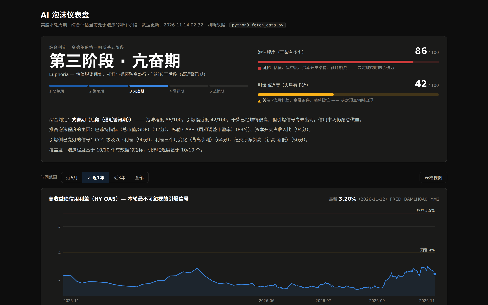
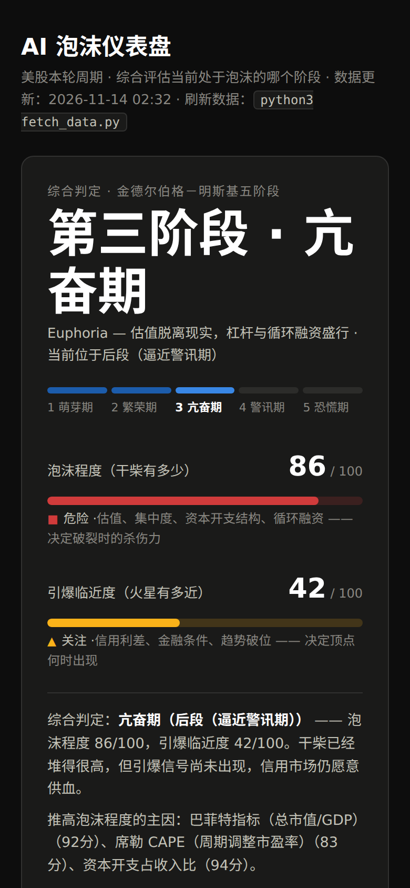

# AIバブル・ダッシュボード

[简体中文](README.zh-CN.md) | [English](README.en.md) | **日本語**

今回の米国株のAI相場が、バブルのどの段階にあるかを判断するための個人用リサーチツールです。フレームワークも依存ライブラリもない静的ページで、`index.html`を開くだけで使えます。画面は中国語です。

公開版：https://bubble.chenfangfang.top

<p>
  
  
</p>

## 使い方

普段は`启动仪表盘.command`をダブルクリックするだけです（macOS）。データが12時間より古ければ取り直し（30秒ほど）、ページを開きます。

手動で行う場合：

```bash
python3 fetch_data.py     # 最新データを取得して data/data.js を生成
open index.html           # ブラウザーで直接開く（サーバー不要）
```

> ページ自身がデータを取りに行かないのは、ブラウザーのクロスオリジン制限（CORS）で、ローカルのページからFREDのAPIを直接読めないためです。取得はスクリプトで行い、起動用ファイルが2つの手順をまとめています。

## 評価モデル（2軸×5段階）

- **バブルの大きさ（薪の量）**：シラーCAPE、バフェット指標、市場の集中度、設備投資の伸びと強度、社債の発行額、循環型の資金調達、AIの実用化率、プライマリー市場の過熱（IPOブーム）、規制当局の警告。崩れたときの痛手の大きさを決めます。
- **崩壊の近さ（火花の近さ）**：ハイイールド債スプレッドとその3か月の変化、CCC格のスプレッド、金融環境指数、イールドカーブ、VIX、200日移動平均からの乖離、NYSEの新高値・新安値の差（市場の幅との乖離）、新規株式の供給による資金の吸い上げ、フリーキャッシュフローがマイナスに転じた企業の数。天井がいつ来るかを決めます。

このうち「新規株式の供給による資金の吸い上げ」がレベル3（資金調達は盛んなのに指数が伸びない）に達したら、今回のサイクルで最優先で対応すべき天井のサインとみなします。「新高値・新安値の差」は、Reutersや取引所のデータから毎週手で更新します。

各指標は区間ごとのしきい値で0〜100点に補間し、重み付けして2軸のスコアにまとめ、キンドルバーガー＝ミンスキーの5段階（萌芽期 → 好況期 → 熱狂期 → 警戒期 → パニック期）に対応づけます。しきい値と重みは`index.html`の`INDICATORS`にあり、自由に調整できます。

## データの更新

| 種類 | 更新方法 | 目安 |
| --- | --- | --- |
| 自動指標（FRED：スプレッド、VIX、金融環境、S&P 500など） | `python3 fetch_data.py` | 毎週、または見たいとき |
| シラーCAPE | スクリプトがmultpl.comから自動取得し、失敗したら手入力の値を使う | 自動 |
| 手動指標（設備投資、循環型の資金調達、集中度など） | `data/manual.json`を編集してスクリプトを再実行 | 四半期ごと、決算期のあと |
| 主な出来事のタイムライン | `data/manual.json`の`events` | 随時 |

## 公開版

- URL：https://bubble.chenfangfang.top（中国本土からも開けます）
  - 予備：https://ai-bubble-dashboard-dpytzro6ok9e.edgeone.dev（中国本土からは開けないことがあります）
  - 独自ドメインのDNSはCloudflareで、CNAMEをプロキシなしでEdgeOneに向けています。証明書はEdgeOneの無料証明書（TrustAsia、自動更新）です。`*.edgeone.dev`の既定ドメインは中国本土でDNS汚染を受けるため、独自ドメインを使っています。
- データの自動更新：GitHub Actionsが毎日22:30 UTC（日本時間7:30）に`fetch_data.py`を実行し、`data/data.js`をコミットします（`.github/workflows/refresh-data.yml`）。Actionsの画面から手動でも実行できます。
- ホスティング：Tencent CloudのEdgeOne Pages（無料、ICP備案不要、中国本土からアクセス可能）。このリポジトリと連携していて、pushのたびに自動で再デプロイされます。手動指標を更新するときは、`manual.json`を編集し、ローカルでスクリプトを一度実行して確認してから`git push`すれば、公開版にも反映されます。

## ハマりどころ

- **FREDのファイアウォールが偽装したUser-Agentを遮断する**：`fredgraph.csv`はAPIキー不要ですが、`Mozilla/5.0 ...`のようにブラウザーを装ったUser-Agentを付けるとWAFに切られます（タイムアウトやHTTP/2 INTERNAL_ERRORになる）。curlの既定のUser-Agentならすぐ返ってきます。スクリプトはFREDに独自のUser-Agentを付けず、2秒の間隔と、失敗時のバックオフ付き再試行で補っています。
- **macOSのPythonでSSL証明書のエラー**：システムのPythonにルート証明書がないと`CERTIFICATE_VERIFY_FAILED`になります。スクリプトはシステムの`curl`を優先して使い、これを避けています。

## モデルの外で注視しているサイン

1. ハイイールド債スプレッドが**4%を超えて**戻らない：資金繰りの引き締まりが確定する
2. 超大手クラウド事業者のどこかが**設備投資の見通しを下方修正**する：2000年3月と同じ筋書き
3. AI関連の**起債金利が跳ね上がる、または発行が不調になる**：資金調達の窓が閉じた日が終わりの日

## スクリーンショットについて

`docs/screenshots/`の画像は、GitHub Actionsの「README 截图」ワークフローがヘッドレスChromeで`index.html`を開いて撮影しています。更新するときはActionsのページから手動で実行してください。

## 免責事項

個人のリサーチツールです。スコアのモデルは主観的に設定したもので、投資助言ではありません。
